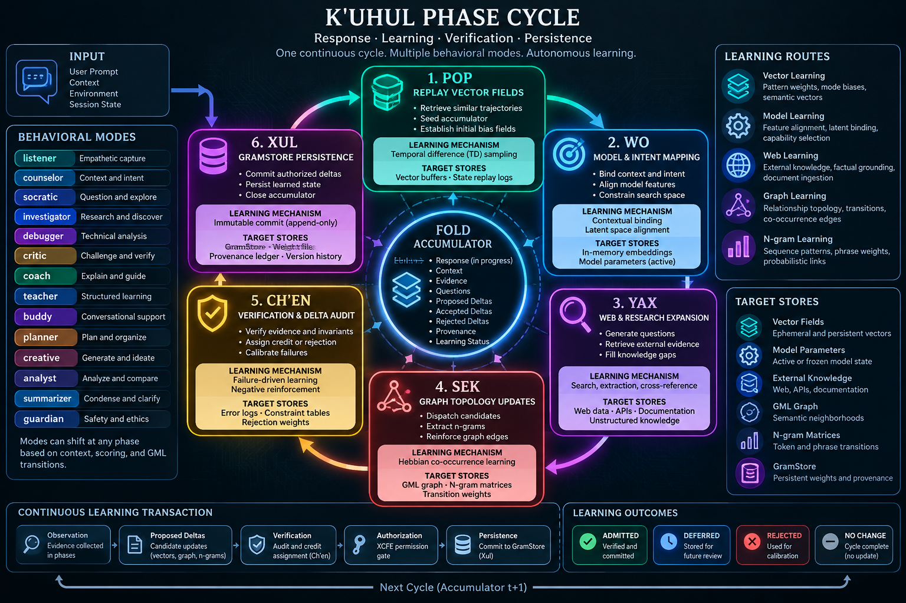

# GML — Graph Map Language



**Repository:** https://github.com/cannaseedus-bot/GML  
**Clone:** `git clone https://github.com/cannaseedus-bot/GML.git`

```text
B  =  authoritative discrete topology
GML ≠ VECTOR  ·  topology-before-coordinates
ParsedGraph ≠ VerifiedGraph ≠ B
```

---

## What is K'UHUL?

**K'UHUL is a graph-native, phase-governed computational language and runtime.** A K'UHUL program isn't a list of instructions — it's a **constrained topology of possible transformations**. Execution is the phase-governed traversal and resolution of that topology.

GML is the foundation of that topology. `topology-before-coordinates` is a primary law: the graph's relational shape (nodes, typed edges, operator fields) is prior to any vector embedding or geometric arrangement derived from it. The graph defines what transformations are structurally possible. The phase cycle (Pop→Wo→Yax→Sek→Ch'en→Xul) governs how those possibilities are unfolded, verified, and committed.

**The graph is not input to an external algorithm. The graph is the program.**

K'UHUL treats graph topology as a **machine-executable computational space**. Nodes encode operations and state, edges encode relationships and dependencies, and phase-governed traversal transforms that space without requiring any visual rendering.

Coordinate fields (`x`, `y`, `z`) in GML nodes are **projection metadata** — they describe how to render or visualize the topology in some geometric space. They are not the topology. Two graphs with identical edges and operators but different coordinates are the same program. The computational world is the relational structure, not the coordinate space it is embedded in.

---

## What is GML?

GML is **Graph Map Language** — not graph machine learning.

It is the **topology substrate `B`**: the authoritative discrete graph that K'UHUL fold operations traverse. The *map* in GML names the **anamorphism** (unfold) — the fold map function walks GML edges to generate candidate-continuation structure before the cata (Xul) collapses it back to a committed answer.

In the phase cycle infographic above, GML appears at **Sek (phase 4)** — *Graph Topology Updates* — where the fold extracts n-grams and reinforces graph edges. The fold-map walk is the Q3×C6 product: 3D hypercube topology × C6 phase cycle.

---

## Fold-Map Connection

| Fold algebra term | GML role |
|-------------------|----------|
| `B` | Authoritative discrete topology — this is a GML graph |
| `M_mu` | VECTOR-µ learned geometry *over* B — derived, never authoritative |
| `unfold` / ana | Walks GML edges; generates fold-candidate structure (Wo→Yax→Sek) |
| `fold` / cata | Collapses KFOLD/1 phase slices to committed answer (Ch'en→Xul) |
| `unfold-graph.gml` | Q3×C6 (48 nodes, 120 edges) — phase-aware neighbor map |
| `khanary_topology.gml` | Q3-hypercube cognitive track adjacency (REASON-µ, ELIZA, MEM-µ, …) |

**Laws:**
- `topology-before-coordinates` — GML graph shape precedes any learned geometry
- `GML != VECTOR` — VECTOR-µ learns geometry over B; it cannot redefine B
- `ParsedGraph ≠ VerifiedGraph ≠ B` — parse → validate → admit are three separate gates
- `semantic_authority = false` — GML files are topology contracts, not truth certificates

---

## Grammar Layers

| File | Purpose |
|------|---------|
| [`gml-1.ebnf`](gml-1.ebnf) | **GML/1** — fold-map interface contract: nodes, edges, relation verbs, WCR weights, phase/epistemic state, overlay IDs, validation grades |
| [`gml.khanary.ebnf`](gml.khanary.ebnf) | **Khanary full grammar** — all extensions: geodesic coordinates, Minkowski events, tensor bundles, quantum graphs, training gradients, Lorentz boosts, deductive system |
| [`gml.validator.json`](gml.validator.json) | **Semantic validator** — 50+ checks across structural (V), relation (R), WCR (W), geometry (G), statistical decision (S), differential (D), quantum graph (Q), deductive (L), algebraic (A), hyperbolic event (HE), Lorentz boost (LB), tensor bundle (TB), training gradient (T), entropy (E) layers |
| [`gml.manifest.json`](gml.manifest.json) | Loader, topology contracts, vector boundary laws, fold graph law bridge, decision theory extensions |

---

## Validation Pipeline

```
GML text
  → ParseGML       (gml.khanary.ebnf)      → ParsedGraph    grade: PARSED
  → ValidateGML    (gml.validator.json)     → VerifiedGraph  grade: VALID
  → Proposal       (field_dag.cpp)          → Candidate
  → Ch'en          (assert_and_verify)      → Certificate
  → XCFE           (dispatch authority)     → Authorization
  → XulGate        (compare_and_commit)     → B'             grade: ADMITTED
```

A VerifiedGraph (grade VALID) does not automatically update B.  
The admission path **Proposal → Ch'en → XCFE → XulGate** is mandatory for topology mutation.

---

## Relation Verbs

Canonical verbs produce **VerifiedRelations** (confidence = 1.0):

```
@related_to   @delegates_to   @requires    @part_of
@defines      @is_a           @causes      @contradicts
@has_part     @has_property   @possesses   @value
@imports      @calls          @exposes
```

Non-canonical strings → `infer_relation_from_lexical()` → **RelationCandidate** (confidence < 1.0, must pass Ch'en before use in B).

> **Law:** `Representation → Relevance → Candidate → Verification` — not → Truth

---

## Reference Graphs

| File | Graph | Purpose |
|------|-------|---------|
| [`unfold-graph.gml`](unfold-graph.gml) | Q3×C6 — 48 nodes, 120 edges | Phase-aware neighbor map; fold iterations walk this |
| [`khanary_topology.gml`](khanary_topology.gml) | Q3-hypercube, 10 nodes, 15 edges | Semantic adjacency of core cognitive tracks |
| [`hypercube_Q3.gml`](hypercube_Q3.gml) | Q3 — 8 nodes, 12 edges | 3D geodesic reference topology |
| [`hypercube_Q4.gml`](hypercube_Q4.gml) | Q4 — 16 nodes, 32 edges | 4D geodesic reference topology |
| [`ccc_n3.gml`](ccc_n3.gml) | CCC3 — 24 nodes, 36 edges | Cubic-interconnect topology overlay |
| [`ccc_n4.gml`](ccc_n4.gml) | CCC4 — 64 nodes, 96 edges | Higher-order cubic-interconnect topology overlay |
| [`sample.gml`](sample.gml) | Directed 3-cycle | Parser smoke test |

---

## CCC4 — Cube-Connected Cycles: Three Architectures

CCC4 is a cubic, undirected interconnect topology: 64 nodes `(x, y)` where `0 ≤ x < 16`, `0 ≤ y < 4`. Edges are cycle edges within each x-cluster (4-cycle) and XOR edges across clusters. `topology_mutable 0` — topology is fixed; only bindings and state vary across architectures.

The same CCC4 graph is instantiated three ways, each with `execution_policy "host_authorized"` and `binding_policy "external"`:

| File | Schema | Node role | Operator | Bindings |
|------|--------|-----------|----------|---------|
| [`ccc4-neuron.gml`](ccc4-neuron.gml) | `ccc4.neuron.v1` | `scalar-neuron` | `neuron.activation` (relu) | activations / weights / biases |
| [`ccc4-tensor.gml`](ccc4-tensor.gml) | `ccc4.tensor.v1` | `tensor-unit` | `tensor.message_pass` (sum → relu) | tensor states / edge_weights / biases |
| [`ccc4-micronaut.gml`](ccc4-micronaut.gml) | `ccc4.micronaut.v1` | `micronaut` | `micronaut.propose` | inputs / edge_routes / state |

**Authority boundary:** `ccc4-micronaut.gml` nodes carry `authority "proposal_only"` — consistent with FS15. The micronaut proposes over the CCC4 topology; Ch'en verifies, XCFE authorizes, Xul commits.

Node labels use `{4-bit-word}:{cycle-position}` addressing (e.g. `"0011:2"`), matching the Q4 hypercube bit-addressing convention so CCC4 and Q4 overlay IDs align.

---

## WCR Weights

GML nodes carry K'UHUL WCR scoring fields:

| Field | WCR role | Range | Default |
|-------|----------|-------|---------|
| `confidence` | C — epistemic confidence | [0, 1] | 1.0 |
| `static_weight` | W — structural weight | [0, 1] | 1.0 |
| `health` | node health | [0, 1] | 1.0 |

Edges carry `weight` (default 1.0) and `loss_cost` (L(θ,a) for decision-theory admissibility checks).

Overlay node IDs are namespaced by file stem: `@node:gml:{stem}:{int_id}`  
Example: `data/khanary_topology.gml` → `@node:gml:khanary_topology:3`

---

## Cross-References

| Repo | Role |
|------|------|
| [micronaut-daemon](https://github.com/cannaseedus-bot/micronaut-daemon) | C++ parser (`src/world/gml_parser.cpp`), field DAG builder (`src/world/field_dag.cpp`), `gml.exe` build target, 70+ `.gml` data files, conformance suite |
| [KUHUL-ES](https://github.com/cannaseedus-bot/KUHUL-ES) | TypeScript KHL runtime; `grammars/gml-1.ebnf` fold-map interface; KFOLD/1 fold graph that GML topology underlies |
| [key-grammar-kit](https://github.com/cannaseedus-bot/key-grammar-kit) | ⟁KEY vocabulary (19 keys), field-factory, GML validator, AIML/GML mapping contracts |

---

## Authority Boundary

GML files are topology contracts — `semantic_authority = false` for all GML projections.

- **VECTOR-µ / METRIC-µ / TENSOR-µ** may learn geometry *over* B; they cannot redefine the graph topology.
- Only an **authorized Xul commit** (Ch'en → XCFE → XulGate) may mutate B.
- Statistical risk (`loss_cost`, `risk_bound`) constrains projection admissibility only — it cannot verify a relation or commit B.
- Hyperbolic event geometry (`field_kind = "hyperbolic_event"`) routes candidate continuations only — `topology_authority = false`.
